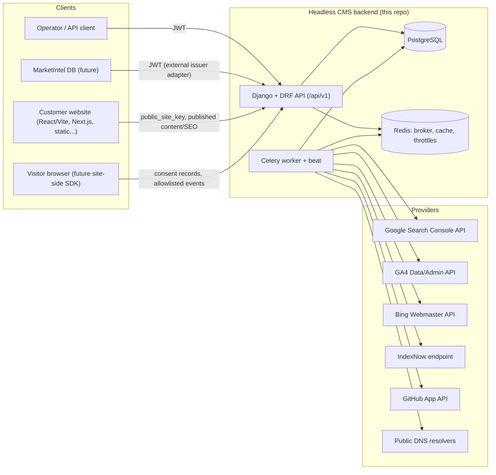

# Architecture

**Status:** Stage 0 baseline design. Stage 1 will confirm dependency versions; any deviation is recorded here with a rationale.

## 1. Context



Key boundaries:
- **Only the worker talks to external providers.** Request handlers enqueue jobs and return `202` with a job resource. Short reads are the one exception: listing GSC properties during connect may be synchronous, but only with a strict timeout and through the same adapter.
- **Public surface (`/api/v1/public/...`)** is unauthenticated, keyed by `public_site_key`, read-only except for consent and event ingestion, and heavily throttled.
- **Management surface (`/api/v1/...`)** requires a bearer JWT. Every query passes through tenant-scoped service/queryset helpers.

## 2. Technology (defaults; final pins in Stage 1)

| Concern | Choice | Why |
|---------|--------|-----|
| Runtime | CPython 3.12/3.13 | Broad wheel availability; supported by current Django |
| Framework | Django (current LTS line) + DRF | Prompt default; mature auth/ORM/migrations |
| DB | PostgreSQL 16/17 | JSONB, partial unique indexes, row locks; tests run against real PG |
| Jobs | Celery + Redis | Prompt default; retries, beat scheduling |
| OpenAPI | drf-spectacular | Maintained, OpenAPI 3 |
| Auth | djangorestframework-simplejwt (rotation + blacklist) | Short-lived access, rotating refresh, revocation |
| Crypto | `cryptography` (AES-GCM envelope / Fernet MultiFernet for key rotation) | Encrypt OAuth tokens at rest |
| DNS | dnspython | TXT verification without HTTP fetching |
| HTTP egress | httpx behind `common.net.SafeClient` | Timeouts, size caps, IP pinning |
| Tests | pytest, pytest-django, factory-boy, respx (httpx mocks), pytest-cov | Prompt default |
| Quality | ruff (lint + format), mypy (django-stubs) on core modules, bandit, pip-audit, gitleaks | Prompt default |
| Logging | structlog (or stdlib JSON formatter) with redaction processor | Structured logs |

Each dependency added in Stage 1+ is justified in `docs/engineering/dependencies.md`.

## 3. Module layout

```
cms/                       # Django project (settings split: base/dev/test/prod)
apps/
  common/      # errors, pagination, throttling, logging/redaction, net (SSRF-safe egress), crypto, jobs policy, health
  accounts/    # User, auth endpoints, token lifecycle, invitations, external-issuer auth adapter
  tenancy/     # Workspace, WorkspaceMembership, roles, permission classes, scoped queryset helpers
  audit/       # AuditEvent model + record_audit() service (no imports from feature apps)
  sites/       # Site, SiteDomain, DomainVerification, state machine, integration guide
  content/     # ContentTypeDefinition, ContentEntry, ContentRevision, publish services, public delivery
  seo/         # PageSEO, SiteSEOSettings, RedirectRule, sitemap/robots, audit, JSON-LD validation
  search_integrations/  # provider interface; google/, bing/, indexnow/ adapters; IndexingJob
  analytics/   # AnalyticsConnection (GA4), report jobs/snapshots, first-party ingestion & aggregates
  consent/     # ConsentConfiguration, ConsentPolicyVersion, ConsentRecord, retention
  github_integration/   # feature-flagged GitHub App onboarding, detection, PR generation
tests/         # mirrors apps/, plus tests/security, tests/smoke
docs/
```

**Dependency direction** ("X → Y" means X may import Y; enforced by review, and later by an import-linter contract if added):
`search_integrations → seo → content → sites → tenancy → accounts → common`, and every app may import `audit.services.record_audit` and `common`.
`audit` imports only `common`; its models reference `accounts.User`, `tenancy.Workspace`, and `sites.Site` via lazy string foreign keys, so tenancy/sites can record audit events without an import cycle. `analytics` and `consent` depend on `sites` (and `analytics` reads `consent` decisions through a service function). `github_integration` depends on `sites`. Feature apps never import each other's models in the reverse direction. Cross-app reactions (publish → sitemap/indexing) go through a small in-process domain-event dispatcher (`common.events`) and run in `transaction.on_commit`.

## 4. Data model (initial)

All tables use a UUID primary key (`id`, uuid4), plus `created_at`/`updated_at`. Tenant-owned rows carry `workspace_id` (directly or via `site_id → workspace_id`). The site-owned rows that are queried most also denormalize `workspace_id`, so scoping filters are single-join and indexable.

| Entity | Key fields | Constraints / notes |
|--------|-----------|---------------------|
| User | email (unique, case-insensitive), is_active, password (Argon2/PBKDF2) | Custom user model from day one |
| Workspace | name, slug, status (active/suspended) | |
| WorkspaceMembership | workspace, user, role, state | unique(workspace, user); ≥1 active OWNER enforced in service + test |
| Invitation | workspace, email, role, token_hash, expires_at, accepted_at | Stores only the token hash |
| Site | workspace, name, public_site_key (unique, rotatable), framework, environment, status/state | |
| SiteDomain | site, domain (normalized), is_primary, verified_at | Partial unique index on domain where verified |
| DomainVerification | site_domain, method=dns_txt, token_hash/record value, status, expires_at, last_checked_at, attempts | |
| ContentTypeDefinition | site, key, label, schema (JSONB), schema_version | unique(site, key) |
| ContentEntry | site, content_type, slug, locale, status, data (JSONB draft), published_revision, version (optimistic lock) | unique(site, content_type, locale, slug) |
| ContentRevision | entry, number, data, created_by, published_at | unique(entry, number); immutable |
| PageSEO | entry (1:1), title, description, canonical_url, robots flags, og/twitter JSONB, json_ld JSONB, sitemap flags | |
| SiteSEOSettings | site (1:1), defaults, organization info, robots config, sitemap config | |
| RedirectRule | site, source_path, destination, status_code, enabled | unique(site, source_path) |
| IntegrationConnection | site, provider, status, external_ids JSONB, scopes, credential (FK → EncryptedCredential), last_verified_at | unique(site, provider) |
| EncryptedCredential | ciphertext, key_id, created_at, rotated_at | Never serialized |
| OAuthState | state_hash, user, site, provider, pkce_verifier (encrypted), redirect_uri, expires_at, used_at | Single-use |
| IndexingJob | site, provider, kind, urls JSONB (bounded), idempotency_key, status, attempts, next_run_at, error_category | unique(site, provider, idempotency_key) |
| AnalyticsConnection / AnalyticsConfig | site, measurement_id, gtm_id, ga4_property_id, connection FK | |
| ReportSnapshot | site, report_kind, params_hash, data, fetched_at, expires_at | |
| AnalyticsEvent | site, name, occurred_at, visitor_id (pseudonymous), session_id, properties JSONB (allowlisted), consent_basis | Partitioning/retention by date; no IP column |
| ConsentConfiguration | site (1:1), categories, retention_days, jurisdiction flags, current_policy_version | |
| ConsentPolicyVersion | site, version, published_at, categories snapshot | |
| ConsentRecord | site, visitor_id, policy_version, granted JSONB, action (accept/reject/customize/withdraw), recorded_at, expires_at | Append-only |
| AuditEvent | workspace, site (nullable), actor (nullable for system), action, target_type, target_id, metadata JSONB (redacted), created_at | Append-only |
| GitHubInstallation / GitHubRepoLink | site, installation_id, repo full_name, branch, status | Feature-flagged |

## 5. Tenancy and authorization

- **Single enforcement point:** `tenancy.scoping` exposes `scoped(qs, user, *, workspace=None, site=None, min_role=...)` plus DRF permission classes (`IsWorkspaceMember(role>=X)`). ViewSets get `get_queryset()` from a base class that always scopes the queryset; there is no unscoped `Model.objects` in views (review checklist item, enforced by a grep test).
- **Lookups out of scope return 404**, so object existence never leaks across tenants.
- **Background jobs** carry `site_id` and `workspace_id`, and re-check the site/workspace status before acting.

### Role matrix (v1)

| Capability | OWNER | ADMIN | EDITOR | ANALYST |
|-----------|:-----:|:-----:|:------:|:-------:|
| Manage workspace settings / delete workspace | ✅ | ❌ | ❌ | ❌ |
| Manage members (non-owner roles) | ✅ | ✅ | ❌ | ❌ |
| Grant/revoke OWNER | ✅ | ❌ | ❌ | ❌ |
| Create/edit/suspend sites, verify domains | ✅ | ✅ | ❌ | ❌ |
| Content types (schema) | ✅ | ✅ | ❌ | ❌ |
| Create/edit/publish entries & page SEO | ✅ | ✅ | ✅ | ❌ |
| Site SEO settings, redirects, robots | ✅ | ✅ | ✅ | ❌ |
| Connect/disconnect integrations, manage credentials | ✅ | ✅ | ❌ | ❌ |
| Trigger/retry indexing jobs | ✅ | ✅ | ✅ | ❌ |
| Consent config / policy versions | ✅ | ✅ | ❌ | ❌ |
| Consent export/delete | ✅ | ✅ | ❌ | ❌ |
| Read content, SEO audit, analytics reports, job status | ✅ | ✅ | ✅ | ✅ |
| Read audit log | ✅ | ✅ | ❌ | ❌ |

EDITOR publish rights follow a workspace policy flag (`editors_can_publish`, default true). If it is set false, EDITOR can only edit drafts.

## 6. Authentication

- First-party: email + password → access JWT (≈5–15 min) + refresh (rotating, blacklisted after use). Bearer header only. **Reuse detection with token-family revocation is not built into simplejwt.** It is a small custom layer (a `family_id` claim plus revocation of every outstanding token in the family when a blacklisted refresh is presented), implemented and tested in Stage 2.
- **Auth adapter boundary:** `accounts.auth_backends.ExternalIssuerAuthentication` validates JWTs from configured issuers (`iss`, `aud`, `exp`, `nbf`, signature via JWKS, allowlisted algorithms RS256/ES256). It maps claims to a local `User` (via an `ExternalIdentity` link table) and to memberships through an explicit mapping service. It is disabled unless configured. Domain logic depends only on `request.user` plus the tenancy services.
- Service-to-service: the same external-issuer mechanism with a client-credentials subject, plus scoped permissions. HMAC-signed webhooks are documented for future use.

## 7. API conventions

- Versioning: URL prefix `/api/v1/`. Breaking changes → `/api/v2/`. A deprecation policy is documented in `docs/api/versioning.md`.
- Errors: `{"error": {"code": "validation_error", "message": "...", "details": {...}, "request_id": "..."}}`.
- Pagination: cursor pagination for large/append-only lists (events, audit, jobs); page-number with `page_size ≤ 100` elsewhere.
- Idempotency: `Idempotency-Key` header supported on mutating integration operations (connect, submit, retry) and publish.
- Async operations return `202 {"job": {...}}`; poll `GET .../jobs/{id}`.

## 8. Jobs and reliability

- Celery queues: `default`, `providers` (rate-limited per provider), `maintenance` (retention, cleanup).
- Policy: `max_retries` per provider, capped exponential backoff with full jitter, and `acks_late` with idempotent handlers. Retries are scheduled on 429/5xx/timeout; 401/403/4xx fail fast with a classified `error_category`. A dead-letter status is reachable via the API with manual retry.
- Beat schedules: DNS re-verification, token refresh, report cache refresh, consent/analytics retention cleanup, stuck-job reaper.

## 9. Security architecture highlights

See [threat-model.md](threat-model.md). Summary:
- `common.net.SafeClient` is the only allowed outbound HTTP path, and `common.dns` the only resolver path. A test forbids importing `requests`/`httpx`/`urllib` elsewhere.
- Secrets live only in env/secret manager. Credential encryption uses a KEK from `FIELD_ENCRYPTION_KEYS` (rotatable list).
- Logging redaction is applied at the processor level, and tests assert that sensitive keys never appear.

## 10. Deployment

- Single container image; process type is selected by command (`api` via gunicorn/uvicorn, `worker`, `beat`, `migrate`).
- Compose for local dev/CI: `api`, `worker`, `beat`, `postgres`, `redis`.
- Config is 12-factor via env. `prod` settings enforce `DEBUG=False`, HSTS, secure proxy header (configurable trusted proxies), and `ALLOWED_HOSTS`.

## 11. Future MarketIntel integration (contract only)

MarketIntel calls this service's `/api/v1` with JWTs from its own issuer, validated by the external-issuer adapter. Its workspace/site mapping goes through stable UUIDs or `external_ref` fields. No shared database. Details: `docs/integrations/marketintel-integration.md` (Stage 2 draft, Stage 9 final).
